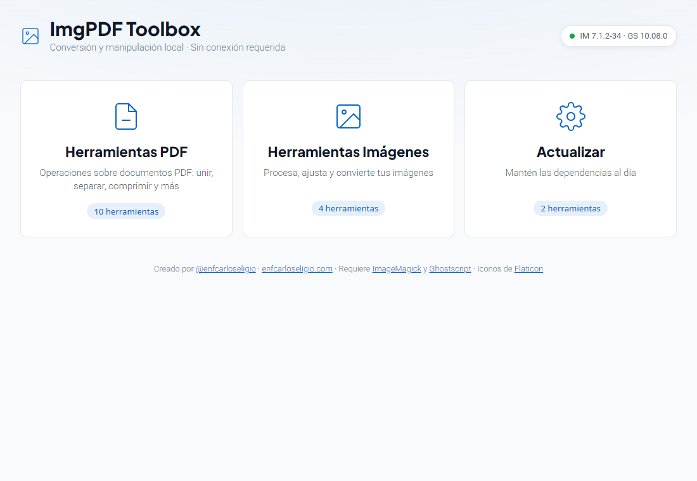
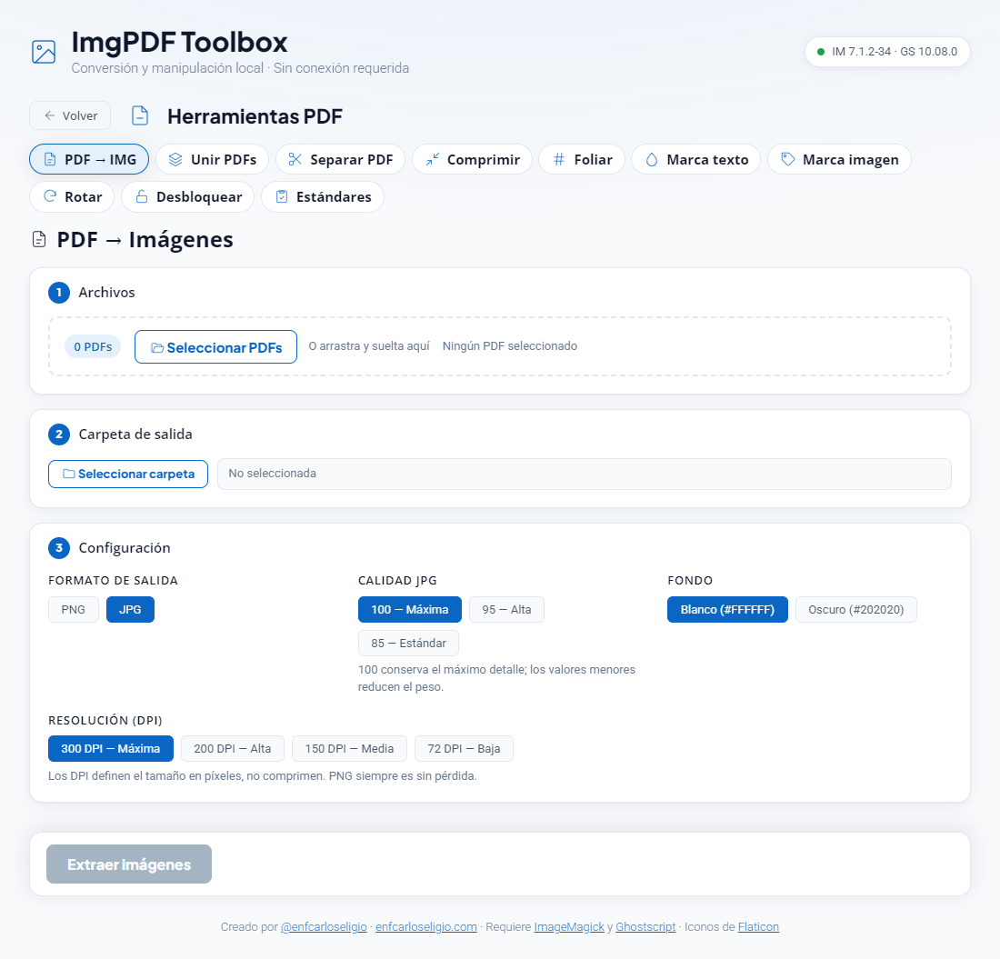
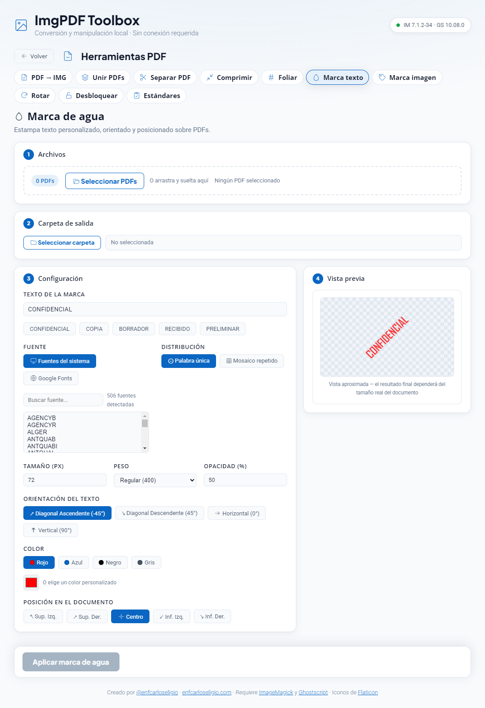
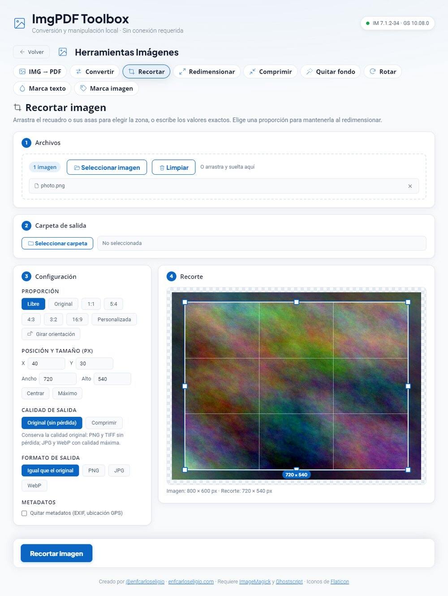
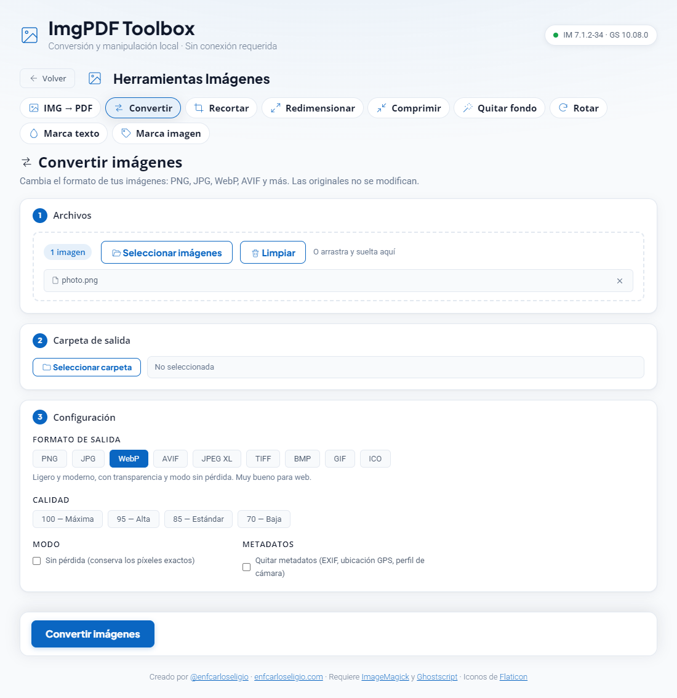

# ImgPDF Toolbox

[](https://github.com/enfcarloseligio/ImgPDF-Toolbox/tags)
[](LICENSE)


Suite de escritorio ligera y de código abierto para convertir, manipular y optimizar **PDFs e imágenes**. Todo el procesamiento ocurre en tu equipo con [Ghostscript](https://www.ghostscript.com) e [ImageMagick](https://imagemagick.org): tus archivos nunca salen de tu computadora.



---

## Contenido

- [Características](#características)
- [Herramientas](#herramientas)
- [Capturas](#capturas)
- [Instalación](#instalación)
- [Desarrollo](#desarrollo)
- [Estructura del proyecto](#estructura-del-proyecto)
- [Privacidad](#privacidad)
- [Créditos y licencias](#créditos-y-licencias)
- [Autor](#autor)

---

## Características

- **Progreso real:** cada operación muestra el archivo en curso y cuántas páginas lleva procesadas del total, con opción de cancelar.
- **Flujo uniforme:** todas las herramientas siguen el mismo orden (archivos → carpeta de salida → configuración → vista previa) y una barra de acción siempre visible.
- **Arrastrar y soltar con posición:** suelta archivos donde quieras insertarlos en la lista; también puedes reordenarla con el asa o las flechas.
- **Calidad sin pérdida cuando la necesitas:** IMG → PDF puede conservar los píxeles exactos de la imagen, PDF → IMG permite elegir la calidad del JPG y el recorte puede guardarse con la calidad original.
- **Edición de imágenes:** convierte entre formatos, recorta con un editor visual y proporciones estándar, redimensiona, comprime y quita fondos de color uniforme.
- **Vista previa en vivo** de marcas de agua y foliado.
- **Tipografías propias:** fuentes del sistema o del catálogo de Google Fonts para marcas de texto y folios.
- **Configuración recordada** por herramienta y última carpeta de salida.
- **Dependencias asistidas:** detecta ImageMagick y Ghostscript, ofrece instalarlos y comprueba si hay versiones nuevas.

## Herramientas

### Herramientas PDF

| Herramienta | Qué hace |
|---|---|
| **PDF → IMG** | Exporta cada página como PNG o JPG con resolución (DPI), calidad JPG y fondo configurables. |
| **Unir PDFs** | Fusiona varios documentos en el orden exacto que definas. |
| **Separar PDF** | Una página por archivo, bloques de N páginas o rangos personalizados (`1-5, 8, 10-12`). |
| **Comprimir** | Reduce el peso con perfiles de Ghostscript (pantalla, digital, impresión y alta definición). |
| **Foliar** | Numeración de páginas, folios consecutivos o con prefijo, sellos de recibido con fecha. |
| **Marca texto** | Marca de agua de texto: orientación, color, opacidad, mosaico y posición. |
| **Marca imagen** | Marca de agua con logo o firma: tamaño, opacidad, ángulo, mosaico y márgenes. |
| **Rotar** | Gira todas las páginas, solo pares o solo impares. |
| **Desbloquear** | Quita restricciones de propietario o abre PDFs con contraseña conocida. |
| **Estándares** | Convierte a PDF/A-1b, 2b, 3b y 4, PDF/X-1a y X-3, PDF/UA-1 y PDF/E-1. |

### Herramientas de imágenes

| Herramienta | Qué hace |
|---|---|
| **IMG → PDF** | Convierte PNG y JPG a PDF. «Original» conserva los píxeles sin recomprimir; el resto aplica compresión proporcional. |
| **Convertir** | Cambia el formato entre PNG, JPG, WebP, AVIF, JPEG XL, TIFF, BMP, GIF e ICO (con tamaños de icono). Controla calidad, modo sin pérdida, fondo de la transparencia y metadatos. Lee además HEIC, SVG y otros. |
| **Recortar** | Editor visual: mueve y redimensiona el recuadro con 8 asas, dibuja uno nuevo o escribe X, Y, ancho y alto. Proporciones 1:1, 5:4, 4:3, 3:2 y 16:9 con su versión vertical (4:5, 3:4, 2:3, 9:16) y proporción personalizada. Guarda con la calidad original o comprimida. |
| **Redimensionar** | Por píxeles exactos, por porcentaje o limitando el lado mayor; manteniendo la proporción o libre (puede deformar), con opción de no ampliar. |
| **Comprimir** | Tres niveles de compresión, conversión opcional a WebP o JPG, límite de tamaño y limpieza de metadatos. Omite lo que no se puede reducir más. |
| **Quitar fondo** | Vuelve transparente un fondo de color uniforme, desde los bordes o en toda la imagen, con tolerancia, gotero y vista previa en vivo. Está pensado para fondos lisos; no recorta siluetas sobre fondos complejos. |
| **Rotar** | Gira imágenes en lote. |
| **Marca texto / Marca imagen** | Las mismas marcas de agua, aplicadas a imágenes. |

## Capturas

| PDF → Imágenes | Marca de agua de texto |
|---|---|
|  |  |

| Recortar imagen | Convertir imágenes |
|---|---|
|  |  |

---

## Instalación

**Requisitos:** Windows 10 u 11.

1. Descarga el instalador desde la sección [Releases](https://github.com/enfcarloseligio/ImgPDF-Toolbox/releases) y ejecútalo.
2. Al abrir la aplicación por primera vez se comprueba si **ImageMagick** y **Ghostscript** están instalados. Si falta alguno, la propia app te guía: abre el asistente de instalación (si el instalador viene incluido) o recurre a `winget`.

> Ghostscript no está en el repositorio de `winget`; si la instalación automática no es posible, descárgalo desde [su sitio oficial](https://www.ghostscript.com/releases/gsdnld.html).

## Desarrollo

**Requisitos:** [Node.js](https://nodejs.org/) 18 o superior, ImageMagick y Ghostscript.

```bash
git clone https://github.com/enfcarloseligio/ImgPDF-Toolbox.git
cd ImgPDF-Toolbox/ImgPDF-Toolbox   # el proyecto Electron está en la carpeta anidada
npm install
npm start
```

Para generar el instalador de Windows (se crea en `dist/`):

```bash
npm run build
```

### Instaladores incluidos (opcional)

Para que el instalador de la aplicación lleve consigo los de ImageMagick y Ghostscript, coloca los `.exe` en `ImgPDF-Toolbox/extraResources/` antes de compilar (la carpeta está excluida de Git por su tamaño). Los nombres deben coincidir con los definidos en `src/ipc-system.js`:

| Herramienta | Archivo esperado |
|---|---|
| ImageMagick | `ImageMagick-7.1.2-34-Q16-HDRI-x64-dll.exe` |
| Ghostscript | `gs10080w64.exe` |

## Estructura del proyecto

```
ImgPDF-Toolbox/
├── ImgPDF-Toolbox/            # Proyecto Electron
│   ├── main.js                # Arranque del proceso principal
│   ├── preload.js             # Puente seguro hacia el renderer (window.api)
│   ├── src/                   # Lógica del proceso principal
│   │   ├── process-runner.js  #   Ejecución y cancelación de Ghostscript / ImageMagick
│   │   ├── progress.js        #   Progreso real por página
│   │   └── ipc-*.js           #   Handlers por área (sistema, conversiones, PDF, anotaciones, imágenes)
│   └── renderer/              # Interfaz (HTML, CSS y JS sin framework)
│       ├── core/              #   Estado, iconos, layout por pasos, lotes, editor de recorte, utilidades, vistas
│       ├── modules/           #   Una herramienta por archivo
│       ├── styles/            #   global.css, modules.css, views.css
│       └── assets/            #   Iconos SVG, tipografías e icono de la app
├── docs/img/                  # Capturas del README
└── LICENSE
```

## Privacidad

ImgPDF Toolbox no usa servidores propios, no recopila datos ni requiere cuenta. Las únicas conexiones de red son opcionales y puntuales: consultar la última versión publicada de ImageMagick y Ghostscript, y descargar una tipografía de Google Fonts cuando la eliges.

## Créditos y licencias

- **Código:** licencia [MIT](LICENSE).
- **[Ghostscript](https://www.ghostscript.com):** © Artifex Software, licencia AGPL v3. La aplicación lo invoca como programa externo.
- **[ImageMagick](https://imagemagick.org):** licencia propia de ImageMagick, basada en Apache 2.0. La aplicación lo invoca como programa externo.
- **Iconos de la interfaz:** diseño propio, con apoyo de [Flaticon UIcons](https://www.flaticon.com/uicons) (licencia gratuita con atribución).
- **Tipografías:** Plus Jakarta Sans, Open Sans y Roboto, empaquetadas con la aplicación.

## Autor

**Juan Carlos De La Cruz Eligio** · [@enfcarloseligio](https://enfcarloseligio.com/)
