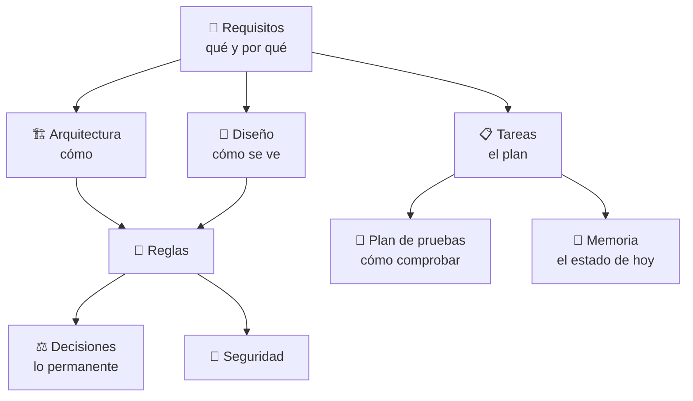

# 📚 Documentación de ImgPDF Toolbox

**Convierte, organiza y protege tus PDFs e imágenes — todo en tu equipo, sin subir nada a internet.**

---

> [!NOTE]
> Los archivos están numerados en **orden de lectura**: de lo más estable (qué y cómo es el producto) a lo más cambiante (qué se hace y en qué estado está).

## 🧭 Mapa de la documentación

| N.º | Documento | ❓ Responde a | 🕒 Cuándo consultarlo |
|:---:|---|---|---|
| 01 | 📚 [LEEME](01_LEEME.md) | Dónde está cada cosa | Al llegar al proyecto |
| 02 | 📘 [REQUISITOS](02_REQUISITOS.md) | **Qué** construimos y **por qué** | Antes de proponer o priorizar una función |
| 03 | 🏗️ [ARQUITECTURA](03_ARQUITECTURA.md) | **Cómo** funciona por dentro | Antes de tocar código o añadir una herramienta |
| 04 | 🎨 [DISEÑO](04_DISEÑO.md) | Cómo debe **verse y sentirse** | Antes de crear o cambiar interfaz |
| 05 | 📜 [REGLAS](05_REGLAS.md) | Las **reglas** de desarrollo | Siempre, antes de programar |
| 06 | ⚖️ [DECISIONES](06_DECISIONES.md) | Decisiones **permanentes** y su razón | Antes de cambiar algo estructural |
| 07 | 🔐 [SEGURIDAD](07_SEGURIDAD.md) | Requisitos y **riesgos** de seguridad | Antes de tocar datos, archivos o procesos |
| 08 | 🧪 [PLAN DE PRUEBAS](08_PLAN_DE_PRUEBAS.md) | Qué significa que algo **funciona** | Antes de publicar cada versión |
| 09 | 📋 [TAREAS](09_TAREAS.md) | El **plan**: versiones, tareas y orden | Para elegir la siguiente tarea |
| 10 | 🧠 [MEMORIA](10_MEMORIA.md) | El **estado de hoy** y el siguiente paso | Al empezar y al cerrar una sesión |

## 🔀 Cómo se relacionan

## 🗂️ Dónde va cada cosa

| Si quieres… | Mira en |
|---|---|
| 🗺️ La **planificación de versiones** y sus tareas | [09 TAREAS](09_TAREAS.md) (detalle) · [02 REQUISITOS](02_REQUISITOS.md) (solo un resumen) |
| 📍 En qué punto estamos **hoy** | [10 MEMORIA](10_MEMORIA.md) (no lleva el plan: enlaza a TAREAS) |
| 🧱 Lo que **no debe cambiar** sin pensarlo | [06 DECISIONES](06_DECISIONES.md) |
| ✅ Saber si una tarea **quedó bien** | [08 PLAN DE PRUEBAS](08_PLAN_DE_PRUEBAS.md) |

## 🚀 Empezar rápido

1. 📘 Lee **REQUISITOS** para entender el producto.
2. 🏗️ Lee **ARQUITECTURA** y 📜 **REGLAS** antes de tocar código.
3. 📋 Elige la siguiente tarea en **TAREAS** y revisa 🧠 **MEMORIA** para ver el estado.
4. 🧪 Al terminar, recorre el apartado correspondiente del **PLAN DE PRUEBAS**.

## 📎 Otros archivos de apoyo (en la raíz del repositorio)

- 📄 `README.md` — presentación pública, instalación y lista de herramientas.
- 🎨 `identidad enfcarloseligio.md` — identidad visual original.
- 🔣 `ICONOS.txt` — dónde se usa cada icono y cómo reemplazarlo.
- 🖼️ `docs/img/` — capturas del README.
