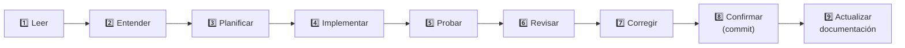

# 📜 REGLAS — Reglas de desarrollo

> [!NOTE]
> Reglas para quien programe en este proyecto (personas o asistentes de IA). Complementan [02_ARQUITECTURA.md](02_ARQUITECTURA.md) y [03_DISEÑO.md](03_DISEÑO.md).

## 🔄 Bucle de trabajo por tarea

Cada tarea de [08_TAREAS](08_TAREAS.md) sigue estos pasos, sin saltarse ninguno:

> [!TIP]
> La rigurosidad escala con el tamaño del cambio: un retoque de una línea es *cambiar → probar → confirmar*; una función grande o un cambio de arquitectura exige plan por escrito, decisión en [05_DECISIONES](05_DECISIONES.md) y revisión.

## 🧠 Antes de programar

1. Leer la documentación relevante (`docs/`) y el archivo que se va a tocar.
2. Inspeccionar lo que ya existe: **reutilizar antes de crear** (cajas de archivos, lotes, vistas previas, selector de color, perfiles de DPI y calidad, miniaturas).
3. Si el cambio es grande o toca varias capas, **planificar primero** y acordar el alcance.
4. Confirmar con el autor las decisiones que cambian el comportamiento visible o la arquitectura.

## 💻 Código

- **Sin `!important`** en CSS. Resolver conflictos con orden de cascada o especificidad.
- **Cabecera de archivo** en todos los archivos: línea `Archivo:` (ruta) y `Descripción:`. Copiar el formato de uno existente.
- **Secciones** con `// ── Título ───` (`/* ── Título ── */` en CSS) que describan cada bloque.
- **Comentarios** en español profesional, que documenten **qué hace** el código para otros desarrolladores. Sin historial de cambios ni lenguaje conversacional («fix de…», «NUEVO:», «ahora…», «v1.3.0»).
- **Funciones pequeñas** y con una sola responsabilidad. No duplicar lógica.
- **No modificar archivos ajenos a la tarea.**
- Nombres de variables y funciones claros; la interfaz y los comentarios, en español.

## 🖥️ Interfaz

- Seguir [03_DISEÑO.md](03_DISEÑO.md). Los colores y espacios salen de las variables CSS, no de valores sueltos.
- Cada herramienta usa la estructura de pasos (`organizeModule`) y **no oculta pasos de forma condicional**.
- **No escribir cajas de archivos a mano:** usar `fileZoneHtml`, `pickFiles`, `fileCountText` y `FILE_KINDS`.
- Las herramientas de imagen por lotes se construyen con `batchFilesHtml`, `batchActionsHtml` y `setupBatchTool`.
- La selección de fuentes usa `buildFontPicker`; no reimplementarla.
- Los iconos son SVG (`icon()`); **nada de emojis** en la interfaz.
- Incluir siempre estados de carga, vacío y error.
- Toda herramienta que cambia un archivo y lo amerita tiene **vista previa fiel**, con zoom, que usa los **mismos argumentos** que el proceso real.

## 💎 Calidad de los archivos

- **Valores por defecto sin pérdida:** 300 DPI y calidad 100 % en todo lo que los ofrezca.
- **No recomprimir si no hace falta** (p. ej. Rotar solo cambia la rotación o la orientación).
- Las pérdidas de calidad deben ser **elegidas** por el usuario y explicadas en la interfaz.

## ⚙️ Procesos y datos

- Procesos externos con **listas de argumentos**, no con cadenas de shell.
- Las operaciones largas informan **progreso real** y se pueden **cancelar** sin dejar archivos a medias.
- Cada canal IPC nuevo lleva su función en `preload.js`.
- Validar toda entrada que llegue desde el renderer (rutas, números, colores, listas).
- `package.json` → `build.files` debe incluir cada carpeta de ejecución nueva.

## 🔐 Seguridad

- No exponer claves ni rutas internas al renderer.
- No añadir conexiones de red sin documentarlas en [06_SEGURIDAD.md](06_SEGURIDAD.md) y en el README.
- Los datos sensibles (firmas, avances de testado) se tratan según [06_SEGURIDAD.md](06_SEGURIDAD.md).

## 🧪 Pruebas

- Antes de dar una función por terminada: revisar la sintaxis de los archivos tocados, probar con archivos reales y recorrer el apartado correspondiente de [07_PLAN_DE_PRUEBAS.md](07_PLAN_DE_PRUEBAS.md).
- La lógica que no depende de Electron se prueba de forma aislada con Node.
- Cuando algo falla, corregir antes de seguir con la siguiente tarea.
- **Revisión antes de publicar una versión:** comparar lo hecho con [01_REQUISITOS](01_REQUISITOS.md), [02_ARQUITECTURA](02_ARQUITECTURA.md), [03_DISEÑO](03_DISEÑO.md), estas reglas y [06_SEGURIDAD](06_SEGURIDAD.md). Comprobar corrección, arquitectura, seguridad, manejo de errores, accesibilidad, diseño responsive, rendimiento y código duplicado. **Que funcione no basta**: se informa primero de los problemas (por gravedad) y después se corrigen.
- Al reportar un error se indica: qué se esperaba, qué ocurre, pasos para reproducirlo y la causa raíz antes de tocar el código.

## 🌿 Git y versiones

- Los cambios de cada versión van **directo a `main`**, con commits descriptivos en español y prefijo (`feat:`, `fix:`, `docs:`).
- **Excepción:** una reestructuración grande (como partir el código en `src/` y `core/`) se hace en una rama, para poder revertirla.
- Cada versión: subir el número en `ImgPDF-Toolbox/package.json`, confirmar, **etiquetar `vX.Y.Z`**, subir `main` y la etiqueta, y generar el instalador.
- Publicar el Release de GitHub requiere decisión del autor.
- Los archivos de contexto de trabajo no se suben al repositorio (ver `.gitignore`).
- **Sin coautoría ni atribución de herramientas de IA** en los commits, ni en las descripciones de cambios: la autoría y la responsabilidad son de quien publica.
- Antes de cada commit se comprueba qué se va a subir (`git diff --cached --name-only`) para que no entren archivos privados.

## 📚 Documentación

- Cada versión actualiza el README y, si cambia algo estructural, los documentos de `docs/`.
- [09_MEMORIA.md](09_MEMORIA.md) se actualiza al cerrar cada sesión de trabajo importante.
- Las decisiones técnicas duraderas se registran en [05_DECISIONES.md](05_DECISIONES.md).
- Los documentos de `docs/` **sí** pueden usar emojis, tablas, avisos y diagramas para facilitar la lectura; la interfaz de la aplicación, no.
- Toda función nueva se construye con Ghostscript e ImageMagick (excepción: `pdf-lib` para ediciones estructurales; ver ADR-019 en [05_DECISIONES](05_DECISIONES.md)).
