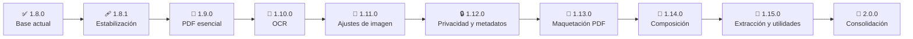

# 📋 TAREAS — Plan de trabajo y hoja de ruta

> [!NOTE]
> Se trabaja **una tarea a la vez**: implementar → probar ([08_PLAN_DE_PRUEBAS](08_PLAN_DE_PRUEBAS.md)) → revisar → marcar → siguiente.
> Cada versión cierra con: README actualizado, número de versión, etiqueta `vX.Y.Z`, subida a `main` e instalador. Ver [05_REGLAS](05_REGLAS.md).

> [!IMPORTANT]
> **Principio de la ruta:** todo lo nuevo se construye con **Ghostscript** e **ImageMagick**, sin dependencias nuevas. La única excepción es `pdf-lib` (ya incluida desde 1.8.0), solo para ediciones estructurales que **no deben reprocesar** el contenido del PDF (giro de páginas y metadatos). Ver [06_DECISIONES](06_DECISIONES.md) ADR-019.

**Leyenda:** ✅ hecho · ⏳ en curso · 🔜 pendiente · **Esfuerzo:** `S` pequeño · `M` medio · `L` grande

---

## 🗺️ Ruta hasta la 2.0.0

| Versión | Tema | Motor principal | Estado |
|---|---|---|---|
| 1.8.0 | 🚀 Quitar fondo avanzado, miniaturas, vistas previas, Canvas, Rotar sin pérdida | Ghostscript + ImageMagick | ✅ Publicada |
| 1.8.1 | 🩹 Estabilización | — | 🔜 |
| 1.9.0 | 📄 PDF esencial | Ghostscript | 🔜 |
| 1.10.0 | 🔎 OCR (texto buscable) | Ghostscript (Tesseract integrado) | 🔜 |
| 1.11.0 | 🎨 Ajustes de imagen | ImageMagick | 🔜 |
| 1.12.0 | 🔒 Privacidad y metadatos | ImageMagick + Ghostscript | 🔜 |
| 1.13.0 | 📐 Maquetación de PDF | Ghostscript + ImageMagick | 🔜 |
| 1.14.0 | 🧩 Composición de imágenes | ImageMagick | 🔜 |
| 1.15.0 | 🧰 Extracción y utilidades | Ghostscript + ImageMagick | 🔜 |
| 2.0.0 | 🏁 Consolidación y madurez | — | 🔜 |

---

## 📜 Historial publicado

- ✅ **1.5.0** Herramientas de imagen (convertir, recortar, redimensionar, comprimir, quitar fondo)
- ✅ **1.5.1** Mejoras de flujo y calidad
- ✅ **1.6.0** Testar con avance guardado
- ✅ **1.7.0** Firmar, Flujo de firma, rangos en IMG → PDF y opciones adaptables
- ✅ **1.7.1** Firmas protegidas con contraseña y por nombre
- ✅ **1.7.2** Vista previa real y peso de fuente funcional
- ✅ **1.7.3** Validación de Ghostscript tras instalar, aviso de reinicio, iconos más definidos
- ✅ **1.8.0** Quitar fondo avanzado, miniaturas, vistas previas, modo Canvas, perfiles de DPI y calidad, Rotar sin pérdida

---

## 🩹 Versión 1.8.1 — Estabilización (parche)

- [ ] **T-181-1** Probar 1.8.0 con uso real y recorrer el plan de pruebas completo `S`
  - [ ] Pincel de Quitar fondo (restaurar y borrar) con el mouse
  - [ ] Arrastrar para reordenar miniaturas en IMG → PDF
  - [ ] Selector Contenedor / Canvas en distintos anchos
  - [ ] Soltar archivos desde el Explorador de Windows
  - [ ] Instalación limpia en un equipo sin Ghostscript ni ImageMagick
- [ ] **T-181-2** Corregir lo que salga de las pruebas `M`
- [ ] **T-181-3** Publicar el Release de GitHub `v1.8.0` con notas `S` — decisión del autor
- [ ] **T-181-4** Verificar el icono de la aplicación en el menú Inicio tras una instalación real `S`

## 📄 Versión 1.9.0 — PDF esencial

**Preparación**
- [ ] **T-190-0** Reorganizar el menú PDF por temas (Organizar, Convertir, Anotar, Seguridad…) en `core/views.js` `M`
- [ ] **T-190-1** Componente reutilizable de miniaturas de páginas de PDF `M`

**Funciones**
- [ ] **T-190-2** 🗂️ **Organizar páginas:** reordenar, borrar y extraer con miniaturas `L`
- [ ] **T-190-3** 🔐 **Proteger PDF con contraseña:** cifrado y permisos (imprimir, copiar, editar) — Ghostscript `M`
- [ ] **T-190-4** ⚫ **PDF en escala de grises o blanco y negro** — Ghostscript `S`

## 🔎 Versión 1.10.0 — OCR (texto buscable)

> [!TIP]
> El Ghostscript de Windows ya trae Tesseract integrado (dispositivos `pdfocr8`, `pdfocr24`, `pdfocr32`, `ocr` y `hocr`). Solo hacen falta los archivos de idioma. Probado con 10.08: texto en español con ñ y acentos reconocido correctamente.

- [ ] **T-1100-1** Detectar si el Ghostscript instalado trae los dispositivos de OCR y avisar si no `S`
- [ ] **T-1100-2** Incluir los idiomas `spa` y `eng` en `extraResources/tessdata` y configurar `TESSDATA_PREFIX` al invocar Ghostscript `S`
- [ ] **T-1100-3** 🔎 **Herramienta OCR:** PDF o imagen → PDF con texto buscable (`pdfocr24`), 300 DPI por defecto, con vista previa de página `L`
- [ ] **T-1100-4** 📝 **Salida de texto `.txt`** (dispositivo `ocr`) `M`
- [ ] **T-1100-5** Selector de idioma y soporte para más idiomas como archivos de datos descargables `M`
- [ ] **T-1100-6** Modelo rápido o de mayor precisión («best») a elección `S`
- [ ] **T-1100-7** Pruebas con escaneos reales: calidad, velocidad y consumo de memoria `S`

## 🎨 Versión 1.11.0 — Ajustes de imagen

- [ ] **T-1110-1** 🎚️ **Ajustes de color:** brillo, contraste, saturación, gris y sepia, con vista previa `M`
- [ ] **T-1110-2** 🔄 **Voltear y espejar** (junto a Rotar) `S`
- [ ] **T-1110-3** 🔍 **Enfocar, suavizar y reducir ruido** con antes/después `M`

## 🔒 Versión 1.12.0 — Privacidad y metadatos

- [ ] **T-1120-1** 🏷️ **Editar metadatos del PDF** (título, autor, fecha) o borrarlos — con `pdf-lib`, para no reprocesar el contenido `M`
- [ ] **T-1120-2** 🧹 **Ver y limpiar EXIF y GPS** de imágenes, mostrando primero lo que se quita — ImageMagick `M`
- [ ] **T-1120-3** 📎 **Aplanar formularios y anotaciones** de PDF — Ghostscript `M`

## 📐 Versión 1.13.0 — Maquetación de PDF

- [ ] **T-1130-1** 📚 **Varias páginas por hoja (N-up) y cuadernillo** con vista previa `L`
- [ ] **T-1130-2** ✂️ **Recortar márgenes y cambiar el tamaño de página** (A4, Carta…) `M`

## 🧩 Versión 1.14.0 — Composición de imágenes

- [ ] **T-1140-1** 🖼️ **Collage y hoja de contactos** `L`
- [ ] **T-1140-2** 🧱 **Dividir una imagen en mosaicos** `M`
- [ ] **T-1140-3** 🎞️ **Crear GIF animado** desde una lista ordenada `M`
- [ ] **T-1140-4** 🔲 **Marco, borde y esquinas redondeadas** `S`

## 🧰 Versión 1.15.0 — Extracción y utilidades

- [ ] **T-1150-1** 🖼️ **Extraer imágenes de un PDF** `M`
- [ ] **T-1150-2** 📝 **Extraer el texto de un PDF** (los que ya tienen capa de texto) — Ghostscript `txtwrite` `S`
- [ ] **T-1150-3** 🔬 **Comparar dos imágenes** marcando diferencias `M`
- [ ] **T-1150-4** 🧿 **Generar un juego de iconos** (favicon, apps, redes) `S`

## 🏁 Versión 2.0.0 — Consolidación y madurez

La versión mayor cierra la ruta: ninguna función nueva grande, sino **solidez**.

**🔐 Seguridad** (los 9 riesgos de [07_SEGURIDAD](07_SEGURIDAD.md))
- [ ] **T-200-1** Migrar todas las llamadas a `run()` con cadenas de shell a listas de argumentos `M`
- [ ] **T-200-2** Restringir `open-url` a dominios permitidos y `https` `S`
- [ ] **T-200-3** Añadir una política de contenido (CSP) a `index.html` `S`
- [ ] **T-200-4** Evaluar y activar `sandbox` del renderer `M`
- [ ] **T-200-5** Limitar las claves de `store-get` / `store-set` `S`
- [ ] **T-200-6** Limpieza automática de sesiones, vistas previas y miniaturas temporales `S`
- [ ] **T-200-7** Verificar la huella (hash) de los instaladores incluidos antes de ejecutarlos `S`
- [ ] **T-200-8** Firmar digitalmente el instalador (SmartScreen) `M`

**🧪 Calidad**
- [ ] **T-200-9** Pruebas automáticas con `node --test` de la lógica sin Electron (`background-removal`, `lossless-rotate`, conversiones de color, constructores de argumentos) `M`
- [ ] **T-200-10** Auditoría de accesibilidad (teclado, foco, contraste) `M`
- [ ] **T-200-11** Revisión de rendimiento con lotes grandes (cientos de imágenes, PDFs de cientos de páginas) `M`

**📚 Producto**
- [ ] **T-200-12** Revisión final del menú y de la uniformidad de todas las herramientas `M`
- [ ] **T-200-13** Documentación final (README, capturas actualizadas y todos los documentos de `docs/`) `S`

---

## 🚫 Ideas descartadas o aplazadas

- Segmentación de fondo con IA (fuera de alcance; ver ADR-015).
- Versiones para macOS y Linux.
- Cuentas, nube o sincronización (contradicen el principio de privacidad).
